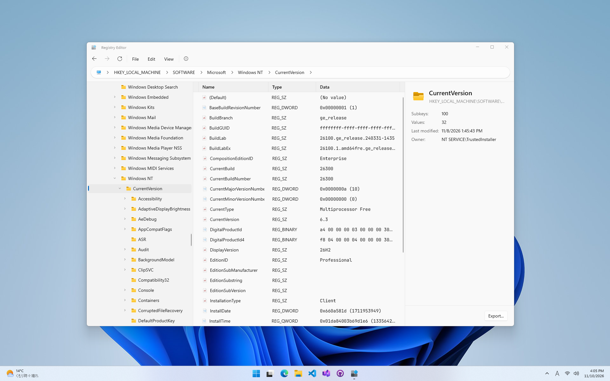

  

<h1 align="center">
  Registry Editor
</h1>

Registry Editor is the next generation Registry editor that replace Regedit.exe. In addition to all Regiedit's features, it supports dark theme, powerful WinUI with fluent controls, and custom color themes.

## Credits

- Huge thanks to [@zeealeid](https://twitter.com/zeealeid) for creating this app's assets.

## Building from source

- Microsoft Windows (x64 or arm64)
- Visual Studio 2026 (.NET 10 SDK)
  - Desktop development with C++
  - WinUI application development

---

